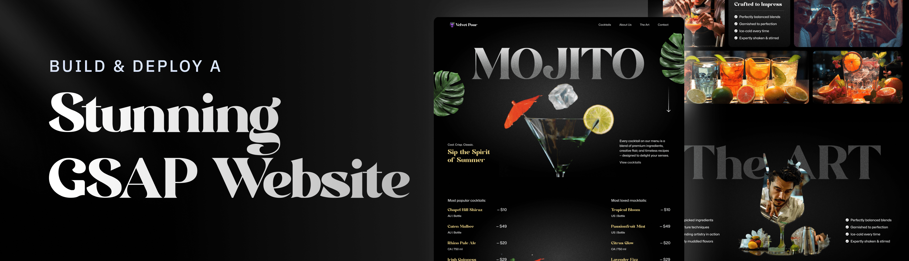

# 🍹 Mojito — GSAP Animated Cocktail Bar Website

A visually immersive cocktail bar landing page built with **React**, **GSAP**, and **Tailwind CSS**. It showcases advanced scroll-driven animations, smooth text splitting, video scrubbing, and mask-reveal effects.

🔗 **Live Demo:** [gsap-practice-project.vercel.app](https://gsap-practice-project.vercel.app/)

---

## 📸 Preview



---

## ✨ Features

- **Scroll-driven animations** — every section reacts to scroll position via GSAP `ScrollTrigger`
- **Text splitting** — hero title and section headings animate letter/word-by-word with `SplitText`
- **Video scrubbing** — a pinned background video plays frame-by-frame as the user scrolls
- **Parallax leaves** — decorative leaf assets move in opposite directions for depth
- **Mask-reveal effect** — the "Art" section expands a masked cocktail image on scroll with a pinned timeline
- **Interactive cocktail slider** — navigate between drinks with animated entry/exit transitions
- **Responsive design** — mobile-aware animation triggers via `react-responsive`
- **Sticky navbar** — transitions from transparent to frosted-glass on scroll

---

## 🗂️ Project Structure

```
gsap-project/
├── public/
│   ├── images/          # All static images (drinks, leaves, icons, profiles)
│   ├── videos/          # Scroll-scrubbed video (output.mp4)
│   ├── fonts/           # Custom font (Modern Negra Demo)
│   └── readme/          # README screenshots
├── src/
│   ├── component/
│   │   ├── Navbar.jsx   # Sticky nav with scroll-based background animation
│   │   ├── Hero.jsx     # Hero title split animation + pinned video scrub
│   │   ├── CockTail.jsx # Cocktail & mocktail menu list with parallax leaves
│   │   ├── About.jsx    # Staggered word reveal + photo grid fade-in
│   │   ├── Art.jsx      # Pinned mask-reveal scroll animation
│   │   ├── Menu.jsx     # Interactive cocktail carousel with GSAP transitions
│   │   └── Contact.jsx  # Footer with opening hours, contact info & socials
│   ├── App.jsx          # Root component; registers ScrollTrigger & SplitText
│   ├── main.jsx         # React entry point
│   └── index.css        # Global styles & Tailwind directives
├── constant/
│   └── index.js         # All static data (nav links, cocktail lists, store info)
├── package.json
└── vite.config.js
```

---

## 🧩 Sections

| Section | Description |
|---------|-------------|
| **Navbar** | Logo + nav links; background animates to frosted glass on scroll |
| **Hero** | "MOJITO" title animates char-by-char; parallax leaves; pinned video scrubs on scroll |
| **Cocktails** | Most popular cocktails & mocktails list with animated leaf parallax |
| **About** | Word-by-word heading reveal + staggered photo grid with noise overlay |
| **The Art** | Pinned section: list items fade out, masked cocktail image expands, inner content reveals |
| **Menu** | Tabbed cocktail slider (Classic Mojito, Raspberry Mojito, Violet Breeze, Curacao Mojito) with GSAP enter animations |
| **Contact (Footer)** | Address, phone, email, opening hours, and social links with leaf animations |

---

## 🛠️ Tech Stack

| Tool | Version | Purpose |
|------|---------|---------|
| [React](https://react.dev) | 19 | UI framework |
| [GSAP](https://gsap.com) | 3.15 | Animation engine |
| [@gsap/react](https://gsap.com/react) | 2.1 | `useGSAP` hook for React integration |
| [ScrollTrigger](https://gsap.com/docs/v3/Plugins/ScrollTrigger/) | (bundled) | Scroll-driven animation |
| [SplitText](https://gsap.com/docs/v3/Plugins/SplitText/) | (bundled) | Character/word/line splitting |
| [Tailwind CSS](https://tailwindcss.com) | 4 | Utility-first styling |
| [react-responsive](https://github.com/contra/react-responsive) | 10 | Mobile breakpoint detection |
| [Vite](https://vite.dev) | 8 | Build tool & dev server |

---

## 🚀 Getting Started

### Prerequisites

- **Node.js** ≥ 18
- **pnpm** (recommended) — or npm / yarn

### Installation

```bash
# Clone the repository
git clone https://github.com/your-username/gsap-project.git
cd gsap-project

# Install dependencies
pnpm install
```

### Development

```bash
pnpm dev
```

Open [http://localhost:5173](http://localhost:5173) in your browser.

### Production Build

```bash
pnpm build
pnpm preview   # preview the production build locally
```

---

## 🎨 Key Animation Techniques

### 1. SplitText + stagger (Hero & headings)
```js
const titleSplit = new SplitText('.title', { type: 'chars, words' })
gsap.from(titleSplit.chars, {
  yPercent: 100, duration: 1.8, ease: 'expo.out', stagger: 0.06
})
```

### 2. Scroll-scrubbed video (Hero)
```js
gsap.timeline({
  scrollTrigger: { trigger: 'video', start: 'center 60%', end: 'bottom top', scrub: true, pin: true }
}).to(videoRef.current, { currentTime: videoRef.current.duration })
```

### 3. Mask-reveal (Art section)
```js
maskTimeline
  .to('.will-fade', { opacity: 0, stagger: 0.2 })
  .to('.masked-img', { scale: 1.3, maskSize: '400%', duration: 1 })
  .to('#masked-content', { opacity: 1, duration: 1 })
```

### 4. Parallax leaves
```js
gsap.timeline({ scrollTrigger: { trigger: '#hero', scrub: true } })
  .to('.right-leaf', { y: 200 }, 0)
  .to('.left-leaf', { y: -200 }, 0)
```

---

## 📦 Deployment

This project is deployed on **Vercel**. To deploy your own:

1. Push the repository to GitHub
2. Import the project at [vercel.com](https://vercel.com)
3. Vercel auto-detects Vite — no extra configuration needed
4. Click **Deploy** ✅

---

## 📄 License

This project is for learning and practice purposes.
